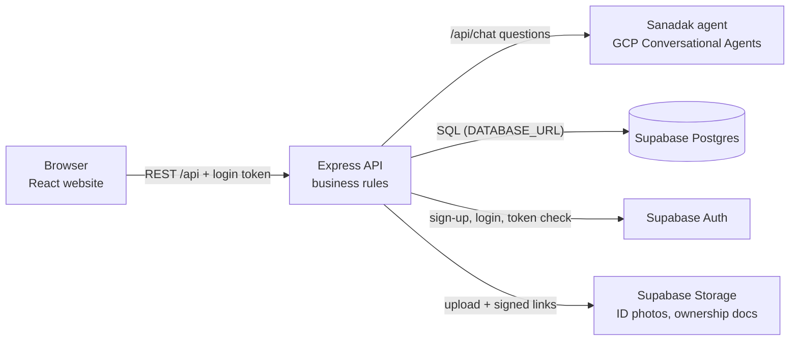

# Numrati API (server)

> Part of **Numrati | نمرتي**, a marketplace for distinctive Jordanian license plates (HTU Capstone 2).
> Companion repository: [bashitii/numrati-client](https://github.com/bashitii/numrati-client), the React website that uses this API.

Express + TypeScript backend for Numrati. **All business logic lives here.** Supabase is used only for:

| Supabase part | What we use it for |
| --- | --- |
| Postgres database | All tables (`supabase/migrations/…_schema.sql`). The server connects directly with `DATABASE_URL`. |
| Auth | Sign-up, login, email confirmation codes, password reset. The server calls it; the React app only talks to this server. |
| Storage | Private ID photos and ownership documents. The server uploads them and gives admins short-lived links. |

RLS is enabled on every table with no policies, so the public Supabase Data API can't read or write anything. The only way in is through this server.

```
src/
  index.ts            starts the server
  app.ts              Express app: middleware + all routes
  config/env.ts       reads and checks .env
  db/pool.ts          Postgres connection, query helpers, transactions
  lib/                Supabase clients, HTTP errors
  middleware/         auth (token check, admin/verified guards), validation, error handler
  services/           shared logic: risk score, price estimate, notifications, file storage, audit log
  routes/             one file per feature (plates, chat, admin, ...)
  scripts/seed.ts     demo accounts and data
supabase/migrations/  database schema (tables only, no SQL functions)
```

## Setup

1. Install packages:
   ```bash
   npm install
   ```
2. Create the database tables. **Already done on the `capstone-2` project.** For a new project, open **SQL Editor** in the Supabase dashboard and run the files in `supabase/migrations/` in order (or `npx supabase link --project-ref <ref>`, then `npx supabase db push`).
3. Copy `.env.example` to `.env` and fill it in from the dashboard:
   - `DATABASE_URL`: **Connect** button → *Session pooler* connection string (with your DB password)
   - `SUPABASE_URL`, `SUPABASE_ANON_KEY`, `SUPABASE_SERVICE_ROLE_KEY`: **Project Settings → API Keys**
4. Load the demo data (optional, safe to run again):
   ```bash
   npm run seed
   ```
   Demo logins use the password `Numrati2026`: `admin@`, `mohammad@`, `khaled@`, `ahmad@`, `reem@`, `nour@` (all `@numrati.test`).

   To put the demo back to a clean state (for example right before a presentation), run `npm run reset-demo`. It deletes only the six demo accounts, everything they created and their uploaded files, then seeds again. Real accounts and DVLD plates are not touched.

### Two kinds of listings

- **Owned:** a plate a person owns and resells. Buyers chat with the seller and send purchase requests.
- **DVLD:** a number DVLD still sells and nobody has bought yet. It's shown at its official price, and buyers get a "How to buy from DVLD" guide instead of chat. These plates belong to a special DVLD account that nobody can sign in to. Admins manage them on the **DVLD Plates** page (`/admin/dvld`): add one or a pasted/CSV list, change a price, or remove a plate once it's bought at DVLD.

To add many DVLD plates from a spreadsheet (a "Plate" or "Code" + "Number" column and a "Price" column):

```bash
npm run import-dvld -- path/to/file.xlsx --dry-run   # shows what would be added
npm run import-dvld -- path/to/file.xlsx             # adds them (already-listed numbers are skipped)
```
5. Run it:
   ```bash
   npm run dev
   ```
   Check http://localhost:4000/api/health. It should say `"database": "connected"`.

### Email confirmation

The app supports both modes, set in **Authentication → Sign In / Providers → Email → Confirm email**:

- **Off:** new accounts are signed in right away. Easiest for demos.
- **On:** new users get a 6-digit code to type in. In **Authentication → Emails → Confirm signup**, replace the template with `supabase/templates/confirmation.html` so the email shows `{{ .Token }}` instead of a link. Supabase's built-in email sender only delivers to your project team's addresses and only a few per hour. For real users, set up custom SMTP (Authentication → Emails → SMTP Settings).

Also set **Authentication → URL Configuration → Site URL** to where the website runs (e.g. `http://localhost:5173`). Password-reset links point there.

## How the React app calls it

The client (`Capstone2-client`) calls everything through `src/services/api.ts`. In development, Vite forwards `/api/*` to this server on port 4000 (see `vite.config.ts`), so run both:

```bash
npm run dev                                  # in Capstone2-server (port 4000)
npm --prefix ../Capstone2-client run dev     # the React app (port 5173)
```

For a deployed client, set `VITE_API_URL` (e.g. `https://api.example.com/api`) and add the client's address to `CLIENT_ORIGIN` here.

The client sends the access token from login on every protected request:

```
Authorization: Bearer <accessToken>
```

Tokens last 1 hour. When one expires, call `POST /api/auth/refresh` with the `refreshToken`.
Errors always come back as `{ "error": "message", "details"?: [...] }`.

## Endpoints (all under `/api`)

🔒 = signed in, ✅ = ID-verified, 👑 = admin

**Auth**
- `POST /auth/register` `{ fullName, email, password, phone?, role? }`
- `POST /auth/verify-email` `{ email, code }` · `POST /auth/resend-code` `{ email }`
- `POST /auth/login` `{ email, password }` → `{ session: { accessToken, refreshToken, expiresAt }, user }`
- `POST /auth/refresh` `{ refreshToken }` · `POST /auth/forgot-password` `{ email }`
- 🔒 `GET /auth/me` · `PATCH /auth/me` `{ fullName?, phone? }` · `POST /auth/change-password` · `POST /auth/logout`

**Plates**
- `GET /plates?q=&category=&governorate=&ownership=owned|dvld&verifiedOnly=&featured=&minPrice=&maxPrice=&status=active|sold|all&sort=latest|priceHigh|priceLow|popular&page=&limit=` → `{ items, total, hasMore }`
- `GET /plates/:id`: details, seller, price history, similar plates (counts a view when signed in)
- 🔒✅ `POST /plates`: JSON or multipart with an optional `ownershipDoc` file. The listing waits for admin approval.
- 🔒 `PATCH /plates/:id` `{ price?, category?, governorate? }` · `POST /plates/:id/sold` · `DELETE /plates/:id`
- 🔒 `POST|DELETE /plates/:id/favorite`
- 🔒 `POST /plates/:id/conversation` → `{ conversationId }`
- 🔒✅ `POST /plates/:id/purchase-requests` `{ offeredPrice?, message? }`
- `GET /users/:id`: public seller profile and their listings

**Signed-in user** 🔒
- `GET /me/listings` · `GET /me/favorites` · `GET /me/analytics?days=30`
- `GET /notifications` · `POST /notifications/read` `{ ids? }` · `DELETE /notifications/:id`
- `GET /conversations` · `GET /conversations/:id/messages?after=<lastId>` (poll for new messages) · `POST /conversations/:id/messages` `{ body }` · `POST /conversations/:id/read`
- `GET /purchase-requests?as=seller|buyer` · `POST /purchase-requests/:id/accept|decline` (seller) · `POST /purchase-requests/:id/cancel` (buyer)
- `GET /verification` · `POST /verification`: multipart `idFront`, `idBack`, `selfie`
- `POST /reports` `{ plateId? | reportedUserId?, reason, details? }` · `GET /reports/mine`

**Price estimates**
- `GET /estimates/traits?code=12-345` · `POST /estimates` `{ code, category, governorate, ...traits }`
- 🔒 `POST /estimates/saved` · `GET /estimates/saved` · `DELETE /estimates/saved/:id`

**Admin** 👑
- `GET /admin/dashboard` · `GET /admin/activity`
- `GET /admin/verifications?status=pending` · `POST /admin/verifications/:id/approve|reject` `{ note? }`
- `GET /admin/users?search=` · `POST /admin/users/:id/ban|unban` `{ reason? }`
- `GET /admin/listings?status=pending` (riskiest first) · `POST /admin/listings/:id/approve|reject|suspend|remove|restore|feature|unfeature` `{ reason? }`
- `GET /admin/reports?status=open|new|review|closed` · `PATCH /admin/reports/:id` `{ status, note? }`
- `GET /admin/dvld?search=&page=` · `POST /admin/dvld` `{ plates: [{ code, price }] }` · `PATCH /admin/dvld/:id` `{ price }` · `POST /admin/dvld/:id/remove`

## Sanadak assistant (`POST /api/chat`)

The chat page sends `{ sessionId, messages }` here. The server passes the last question to our Sanadak agent in Google Cloud (Conversational Agents, project `midyear-diorama-514913-a7`), which answers from its playbook and knowledge base. The agent details are in `src/config/env.ts` and the code is in `src/services/sanadak.ts`.

The server signs in to Google with Application Default Credentials:

- **On a laptop:** run `gcloud auth application-default login` once (on a Mac, double-click `Connect Sanadak.command`, which installs the tool and does this).
- **On Cloud Run:** the service runs as the `numrati-backend` service account (role: Dialogflow API Client), so no key file is needed.

## Deploying to Cloud Run

The API is live at https://numrati-api-816529305440.europe-west1.run.app/api (service `numrati-api`, region europe-west1).

To deploy a new version from a Mac, double-click `Deploy to Cloud Run.command`. It uploads this folder, builds it with the `Dockerfile`, and copies the Supabase settings from `.env` into Cloud Run. The service uses:

- **Security → Service account:** `numrati-backend`
- **Variables:** `DATABASE_URL`, `SUPABASE_URL`, `SUPABASE_ANON_KEY`, `SUPABASE_SERVICE_ROLE_KEY`, and `CLIENT_ORIGIN` (the website's address)

## Making someone an admin

Run this in the SQL Editor:

```sql
update profiles set role = 'admin', verification_status = 'verified' where id = (select id from auth.users where email = 'you@example.com');
```

## Architecture (whole project)



- The website never talks to Supabase. Every request goes through the API, which checks who you are and whether you're allowed to do it.
- Row Level Security is on for every table with no policies, so Supabase's public Data API can't read or write anything. Only the server, connected directly to Postgres, can.
- Private files (ID photos, ownership documents) live in private buckets. Admins see them through links that expire after 10 minutes.

## Main features

- **Browse and search** plates by number, category, governorate, price and verified sellers.
- **Accounts**: email sign-up with a confirmation code, login, ID verification (ID front, back and a selfie).
- **Selling**: a 4-step listing wizard with an AI-suggested price and an ownership document upload. Listings wait for admin approval.
- **Buying**: favorites, chat with the seller, purchase requests that the seller can accept or decline.
- **Notifications** for messages, requests, price changes, approvals and rejections.
- **Price estimator**: rule-based valuation (the trained model can replace it later without changing the API).
- **Seller analytics**: views, interested buyers and requests over 7 days to 1 year.
- **Fraud protection**: every listing gets a risk score (price vs. market, account age, past rejections), shown to admins first.
- **Admin panel**: dashboard, ID verification queue, listing review, reports, bans and an audit log of every admin action.
- **Sanadak assistant**: answers questions about plates and DVLD procedures.
